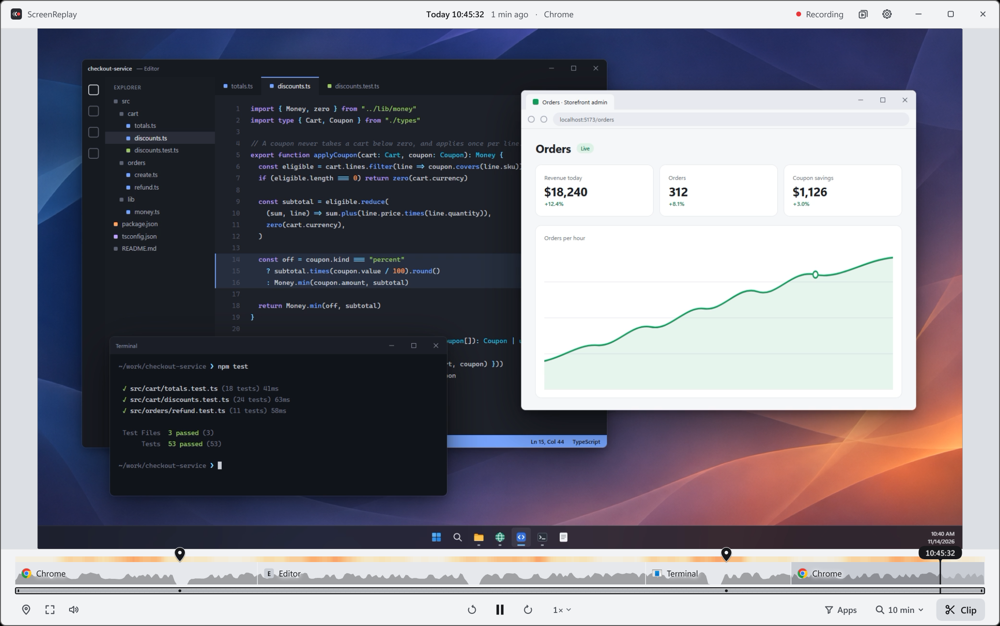

# ScreenReplay

[中文](#中文) · [Website & Installer](https://screenreplay.pages.dev) · [Microsoft Store](https://apps.microsoft.com/detail/9PCZQK5BVPC6)

Always-on background screen recorder and instant replay viewer for Windows 11, inspired by Steam's background game recording and brought to the whole desktop. ScreenReplay keeps a rolling hardware-encoded buffer of the last stretch of your screen and audio (2 hours by default) on your PC, so a bug you cannot reproduce or a moment when OBS was not running can be rewound on a timeline, cropped to a single window, and copied to a chat in seconds.

The replay window (`ScreenReplayViewer.exe`) is written in [MoonBit](https://www.moonbitlang.com) on still.fail's native UI framework [`mbui`](https://github.com/AFK-surf/monoid) (`libs/mbui` and `libs/sf-ui`) — no Electron or WebView, Direct3D 11 hardware video decoding without CPU frame copies, instant wake, ~9.3 MB standalone installer.



## Installation

Requires Windows 11 x64.

- **Microsoft Store**: install [ScreenReplay on the Microsoft Store](https://apps.microsoft.com/detail/9PCZQK5BVPC6) (updates automatically through the Store).
- **Standalone installer**: download `ScreenReplay-Setup.exe` from [screenreplay.pages.dev](https://screenreplay.pages.dev) and run it. It installs under the current user (no administrator rights needed), adds Start menu and Settings › Apps entries, and optionally starts with Windows. The standalone installer is not Authenticode-signed: if Windows SmartScreen prompts "Windows protected your PC", choose **More info › Run anyway**.

### Standalone updates

Settings › About includes **Check for updates** and an **Automatic updates** toggle (on by default in the standalone installer). When enabled, ScreenReplay checks [screenreplay.pages.dev/dl/latest.json](https://screenreplay.pages.dev/dl/latest.json) periodically, verifies the release's ECDSA P-256 signature (against the public key built into `recorder/Updater.cs`) and SHA-256 digest, and silently installs the update once the replay window is closed and the PC has been idle for two minutes. A release whose signature does not verify is rejected before download. The Microsoft Store package is updated by the Store and never checks for updates itself.

## Use

- **Global hotkeys** (configurable in Settings):
  - `Ctrl+Alt+R` (or click the tray icon): open the replay window
  - `Ctrl+Alt+S`: save the last 30 seconds in the background and show a quick card by the tray (Play, Copy, Show in folder)
  - `Ctrl+Alt+M`: drop a marker at the current moment
- **Timeline**:
  - Shows which app was in front at every moment (`windows.jsonl`, kept strictly on this PC), audio loudness, markers, hover thumbnails, and a 100 ms input activity heat strip above the track (keyboard, mouse clicks/wheel, and XInput/HID controller counts only — never which keys or where)
  - **Filter by app**: click the Apps chip to keep only selected apps on the timeline; stretches spent in other apps fold into thin seams showing how much time was skipped
  - Mouse wheel pans horizontally; `Ctrl+wheel` zooms around the pointer; click jumps the playhead; right-click opens the context menu (add marker, copy frame, set clip start/end)
- **Playback**:
  - `Space` or `K` play/pause; `,` / `.` step one recorded frame backward/forward; `←` / `→` jump 5 s (`Shift`: 1 s); `J` / `L` jump 15 s; `Home` / `End` jump to start/end; `[` / `]` jump between markers
  - `Ctrl+wheel` over the picture zooms up to 8× around the pointer (`0` resets); double-click toggles fullscreen
- **Clipping & export**:
  - Press `C` to enter clip mode (`I` / `O` set start/end at the playhead; `Ctrl+Z` / `Ctrl+Y` undo/redo)
  - Clip the **whole screen**, **a single window** (click any recorded window on the canvas; crop follows the window if it moved), or **a custom region**
  - **As recorded**: lossless MP4 remux (`rp_concat`) with an edit list (`edts`/`elst`) for frame-accurate start without re-encoding
  - **By target size**: picks resolution and Peak-Constrained VBR bitrate to fit 10 / 25 / 50 / 100 / 250 MB
  - **Custom**: H.264, H.265, hardware AV1, or ordered-dithered animated GIF
  - `Enter` opens the save sheet; `Shift+Enter` quick-saves and copies the file to the clipboard

All recordings, thumbnails, and window indexes stay on your PC (`%LOCALAPPDATA%\Replay` by default, configurable under Settings › Storage). Nothing is uploaded, and no usage statistics or crash reports are collected.

## How it works

- **`recorder/`** (`ScreenReplay.exe`, C# / Native-trimmed .NET): tray resident process, global hotkeys, rolling 30 s segment lifecycle, foreground window tracker (`WindowTrack.cs`), raw input & gamepad activity counters (`RawInput.cs`, `XInputPads.cs`, `HidPads.cs`), and signed standalone updater (`Updater.cs`).
- **`recording/`** (C#, `Vortice.Windows` Direct3D 11 & Media Foundation):
  - Captures the display via `Windows.Graphics.Capture` straight into GPU VRAM, converts and tone-maps HDR FP16 scRGB → SDR on the GPU via `ID3D11VideoProcessor` (`DisplayColor.cs`, `HdrToSdr.cs`), and encodes H.265 (HEVC) or H.264 through hardware NVENC / AMF / QuickSync MFTs (`VideoEncoder.cs`). Unchanged frames are skipped so a still desktop writes almost nothing.
  - Mixes WASAPI system loopback audio and optional microphone input into AAC (`AudioSource.cs`, `AudioMixer.cs`).
- **`app/`** (`ScreenReplayViewer.exe`, MoonBit + C/C++ on `mbui`):
  - Retained-mode native UI built on `mbui`'s `@view.View` tree and Direct3D 11 renderer (`WDA_EXCLUDEFROMCAPTURE` enabled by default so reviewing past footage does not record the viewer itself).
  - Demuxes MP4 segments directly (`mp4.mbt`, `sps.mbt`) and decodes frames on the GPU via Media Foundation's D3D11VA hardware decoder into an NV12 `ID3D11Texture2D` pool, converted to BGRA on the GPU and presented through `mbui`'s `@ui.Stream` (`native_player.mbt`, `replay_play.cpp`) synchronized against `XAudio2` output latency.
  - Background keyframe thumbnailer (`replay_index.cpp`), lossless MP4 remuxer, GPU window/region cropper (`replay_export.cpp`), and GIF encoder (`replay_gif.cpp`).

## Windows build

Needs Windows 11, Visual Studio 2022 (with **Desktop development with C++**), .NET 10 SDK, Git for Windows (Git Bash), and MoonBit (`moon` on `PATH`, or `MBUI_TOOLS` pointing to a folder containing `moon/`).

> **Note on Windows `MAX_PATH`**: Clone into a short path such as `C:\src\screenreplay` so MoonBit's native C build paths stay well below 260 characters.

```powershell
powershell -File scripts/build.ps1                     # Builds out\ScreenReplay.exe + out\ScreenReplayViewer.exe
powershell -File packaging/pack-setup.ps1              # Builds out\setup\ScreenReplay-Setup-<ver>.exe (Inno Setup 6)
powershell -File packaging/pack-msix.ps1 -Viewer out   # Builds Microsoft Store MSIX package
```

`scripts/fetch-stillfail.sh` (invoked automatically by the build) sparse-fetches `libs/mbui` and `libs/sf-ui` from [`AFK-surf/monoid`](https://github.com/AFK-surf/monoid) at the commit pinned in `stillfail.lock` into `deps/stillfail`.

## Sponsor

ScreenReplay is free and open source. If it saves a moment that mattered, you can support its development on the [sponsor page](https://screenreplay.pages.dev/support) (WeChat Reward, Ko-fi), also linked under Settings › About.

## License

ScreenReplay is free software licensed under the **GNU General Public License v3.0 (GPL-3.0)** — see [`LICENSE`](LICENSE).

**Trademark & branding notice**: The name **"ScreenReplay"** and the ScreenReplay icons/logos (`assets/`, `site/img/icon.png`) are not covered by the GPL-3.0 license. Modified versions or binaries built from modified source code must not be distributed or published under the name "ScreenReplay" or with the official ScreenReplay icons.

Third-party notices: [`THIRD-PARTY-NOTICES.md`](THIRD-PARTY-NOTICES.md) and [`site/licenses.txt`](site/licenses.txt). Privacy policy: [`PRIVACY.md`](PRIVACY.md).

---

## 中文

Windows 11 后台循环录屏与即时回放工具。灵感来自 Steam 自带的后台游戏录像，把它搬到了整个桌面上：在后台用显卡硬件编码循环保留最近一段时间的屏幕和声音（默认 2 小时，旧录像自动清理），遇到闪一下就复现不出来的偶发 Bug，或者打非 Steam 游戏忘了开 OBS，按 `Ctrl+Alt+R` 就能拉回时间线按帧查看、单窗口裁剪导出，一键复制发进群里。

回放器界面（`ScreenReplayViewer.exe`）使用 [MoonBit](https://www.moonbitlang.com) 基于 still.fail 的原生 UI 框架 [`mbui`](https://github.com/AFK-surf/monoid)（`libs/mbui` 与 `libs/sf-ui`）编写，不套 Electron 或 WebView，视频流走 Direct3D 11 硬解零 CPU 拷贝直出，常驻内存小、快捷键秒开，独立安装包约 9.3 MB。


### 安装

需要 Windows 11（x64）。

- **Microsoft Store**：在微软商店搜索安装 [ScreenReplay](https://apps.microsoft.com/detail/9PCZQK5BVPC6)（由商店自动更新）。
- **独立安装包**：在 [screenreplay.pages.dev](https://screenreplay.pages.dev) 下载 `ScreenReplay-Setup.exe` 运行即可，装在当前用户目录下（无需管理员权限），可选开机自启。安装包未做商业代码签名，首次运行若弹出 SmartScreen 提示「Windows 已保护你的电脑」，点「更多信息 › 仍要运行」。

**自动更新**：独立安装包在「设置 › 关于」里提供「检查更新」和「自动更新」开关（默认开启）。开启后定期向 `screenreplay.pages.dev` 检查新版本，校验内置公钥的 ECDSA P-256 签名与 SHA-256 哈希，签名不匹配绝不下载；等回放窗口关闭且键鼠空闲满两分钟后在后台静默完成升级。微软商店版由商店负责更新，自身不联网检查。

### 用法

- **全局快捷键**（可在设置中修改）：
  - `Ctrl+Alt+R`（或点击托盘图标）：打开回放窗口
  - `Ctrl+Alt+S`：不弹窗直接保存刚过去的 30 秒，并在托盘旁弹出快捷卡片（播放、复制、打开文件夹）
  - `Ctrl+Alt+M`：在当前时刻打一个标记
- **时间线**：
  - 标出每一刻的前台应用（`windows.jsonl`，仅存本机）、音量波形、标记点、悬停预览图，以及轨道上方的键鼠与手柄操作强度热力条（每 0.1 秒只记活跃次数，不记录具体按键）
  - **按应用过滤**：点击「应用」筛选只看指定软件，中间切去别的窗口的时段会自动折成细缝跳过
  - 滚轮左右平移，`Ctrl+滚轮` 围绕指针缩放，单击跳转播放头，右键打开菜单（加标记、复制当前帧、设剪辑起止点）
- **播放与微调**：
  - `Space` / `K` 播放暂停；`,` / `.` 前后逐帧步进；`←` / `→` 跳 5 秒（按住 `Shift` 跳 1 秒）；`J` / `L` 跳 15 秒；`[` / `]` 在标记间跳转
  - 在画面上按 `Ctrl+滚轮` 围绕指针最高放大 8 倍（按 `0` 还原），双击画面切换全屏
- **剪辑与导出**：
  - 按 `C` 进入剪辑（`I` / `O` 在播放头设起止点，`Ctrl+Z` / `Ctrl+Y` 撤销重做）
  - 支持导出**整个屏幕**、**单个窗口**（直接点击画面里的目标窗口，窗口移动会自动跟随裁剪）或**自定义框选区域**
  - 支持**原样秒存**（MP4 无损重封装，免重编码）、**按目标体积压缩**（10 / 25 / 50 / 100 / 250 MB）以及**自定义参数**（H.264、H.265、硬件 AV1、GIF 动图）
  - `Enter` 打开保存面板，`Shift+Enter` 快速保存并把文件复制到剪贴板

所有录像、缩略图和窗口记录 100% 只保存在本机（默认 `%LOCALAPPDATA%\Replay`，可在「设置 › 存储」中更改），无广告、无账号，也不收集任何使用统计或崩溃报告。

### 构建

需要 Windows 11、Visual Studio 2022（勾选「使用 C++ 的桌面开发」）、.NET 10 SDK、Git for Windows（Git Bash）以及 MoonBit（`moon` 在 `PATH` 中）。建议克隆到较短路径（如 `C:\src\screenreplay`）以避免触发 Windows `MAX_PATH` 限制，构建命令见上方 [Windows build](#windows-build)。

### 赞助

ScreenReplay 开源免费。如果它帮你留住过关键一刻，欢迎在[赞助页](https://screenreplay.pages.dev/support)请作者喝杯咖啡（微信赞赏 / Ko-fi），「设置 › 关于」里也有入口。

### 许可证

基于 **[GNU General Public License v3.0 (GPL-3.0)](LICENSE)** 开源。注意：**“ScreenReplay”** 名称及应用图标（`assets/`、`site/img/icon.png`）不在 GPL-3.0 授权范围内，基于修改后源码构建或分发的衍生版本不得使用 ScreenReplay 名称与官方图标。第三方组件声明见 [`THIRD-PARTY-NOTICES.md`](THIRD-PARTY-NOTICES.md)，隐私政策见 [`PRIVACY.md`](PRIVACY.md)。
