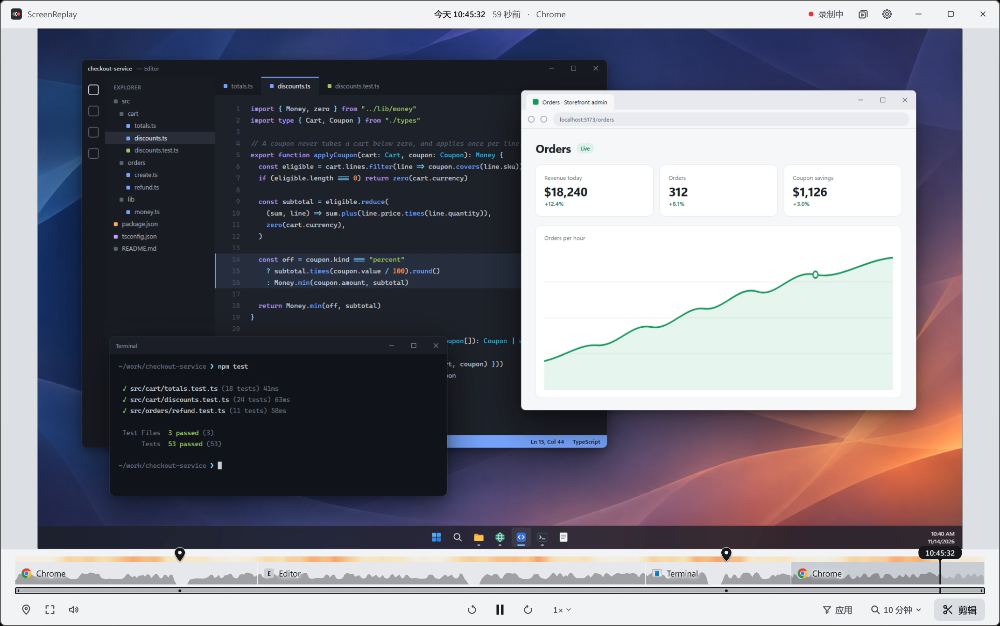

# ScreenReplay

[English](README.md) · [官网与安装包](https://screenreplay.pages.dev) · [Microsoft Store](https://apps.microsoft.com/detail/9PCZQK5BVPC6)

Windows 11 后台循环录屏与即时回放工具。灵感来自 Steam 自带的后台游戏录像，把它搬到了整个桌面上：在后台用显卡硬件编码循环保留最近一段时间的屏幕和声音（默认 2 小时，旧录像自动清理），遇到闪一下就复现不出来的偶发 Bug，或者打非 Steam 游戏忘了开 OBS，按 `Ctrl+Alt+R` 就能拉回时间线按帧查看、单窗口裁剪导出，一键复制发进群里。

回放器界面（`ScreenReplayViewer.exe`）使用 [MoonBit](https://www.moonbitlang.com) 基于 still.fail 的原生 UI 框架 [`mbui`](https://github.com/AFK-surf/monoid)（`libs/mbui` 与 `libs/sf-ui`）编写，不套 Electron 或 WebView，视频流走 Direct3D 11 硬解零 CPU 拷贝直出，常驻内存小、快捷键秒开，独立安装包约 9.3 MB。



## 安装

需要 Windows 11（x64）。

- **Microsoft Store**：在微软商店搜索安装 [ScreenReplay](https://apps.microsoft.com/detail/9PCZQK5BVPC6)（由商店自动更新）。
- **独立安装包**：在 [screenreplay.pages.dev](https://screenreplay.pages.dev) 下载 `ScreenReplay-Setup.exe` 运行即可，装在当前用户目录下（无需管理员权限），会创建开始菜单项与「设置 › 应用」卸载项，可选开机自启。安装包未做商业代码签名，首次运行若弹出 SmartScreen 提示「Windows 已保护你的电脑」，点「更多信息 › 仍要运行」。

### 独立安装包自动更新

「设置 › 关于」里提供**检查更新**按钮和**自动更新**开关（独立安装包默认开启）。开启后定期向 [screenreplay.pages.dev/dl/latest.json](https://screenreplay.pages.dev/dl/latest.json) 检查新版本，使用内置公钥校验 ECDSA P-256 发布签名与 SHA-256 哈希，签名不匹配绝不下载；等回放窗口关闭且键鼠空闲满两分钟后在后台静默完成升级并重启。微软商店版由商店负责更新，自身不联网检查。

## 用法

- **全局快捷键**（可在设置中修改）：
  - `Ctrl+Alt+R`（或点击托盘图标）：打开回放窗口
  - `Ctrl+Alt+S`：不弹窗直接保存刚过去的 30 秒，并在托盘旁弹出快捷卡片（播放、复制、打开文件夹）
  - `Ctrl+Alt+M`：在当前时刻打一个标记
- **时间线**：
  - 标出每一刻的前台应用（`windows.jsonl`，仅存本机）、音量波形、标记点、悬停预览图，以及轨道上方的键鼠与手柄操作强度热力条（每 0.1 秒只记活跃次数，不记录具体按键）
  - **按应用过滤**：点击「应用」筛选只看指定软件，中间切去别的窗口的时段会自动折成细缝跳过
  - 滚轮左右平移，`Ctrl+滚轮` 围绕指针缩放，单击跳转播放头，右键打开菜单（加标记、复制当前帧、设剪辑起止点）
- **播放与微调**：
  - `Space` / `K` 播放暂停；`,` / `.` 前后逐帧步进；`←` / `→` 跳 5 秒（按住 `Shift` 跳 1 秒）；`J` / `L` 跳 15 秒；`Home` / `End` 跳首尾；`[` / `]` 在标记间跳转
  - 在画面上按 `Ctrl+滚轮` 围绕指针最高放大 8 倍（按 `0` 还原），双击画面切换全屏
- **剪辑与导出**：
  - 按 `C` 进入剪辑（`I` / `O` 在播放头设起止点，`Ctrl+Z` / `Ctrl+Y` 撤销重做）
  - 支持导出**整个屏幕**、**单个窗口**（直接点击画面里的目标窗口，窗口移动会自动跟随裁剪）或**自定义框选区域**
  - **原样**：MP4 无损重封装（`rp_concat` + `edts`/`elst` 编辑列表），免重编码秒存
  - **按大小**：自动计算分辨率与峰值受限 VBR 码率以适配 10 / 25 / 50 / 100 / 250 MB
  - **自定义**：支持 H.264、H.265、硬件 AV1 以及自定义调色板有序抖动 GIF 动图
  - `Enter` 打开保存面板，`Shift+Enter` 快速保存并把文件复制到剪贴板

所有录像、缩略图和窗口记录 100% 只保存在本机（默认 `%LOCALAPPDATA%\Replay`，可在「设置 › 存储」中更改），无广告、无账号，也不收集任何使用统计或崩溃报告。

## 工作原理

- **`recorder/`**（`ScreenReplay.exe`，C# / 裁剪自包含 .NET）：系统托盘常驻进程、全局快捷键、30 秒滚动分片管理、前台窗口跟踪（`WindowTrack.cs`）、键鼠与手柄活跃度计数（`RawInput.cs`、`XInputPads.cs`、`HidPads.cs`）以及 ECDSA 签名自动更新器（`Updater.cs`）。
- **`recording/`**（C#，`Vortice.Windows` Direct3D 11 与 Media Foundation）：
  - 通过 `Windows.Graphics.Capture` 直接采集到显存，在 GPU 上经 `ID3D11VideoProcessor` 完成缩放与 HDR FP16 scRGB → SDR 色调映射（`DisplayColor.cs`、`HdrToSdr.cs`），并调用 NVENC / AMF / QuickSync 硬件 MFT 编码 H.265（HEVC）或 H.264（`VideoEncoder.cs`）。画面未变化时不写入，静止桌面几乎零落盘。
  - 通过 WASAPI 采集系统环回音频与可选麦克风输入并混音编码为 AAC（`AudioSource.cs`、`AudioMixer.cs`）。
- **`app/`**（`ScreenReplayViewer.exe`，MoonBit + C/C++，基于 `mbui`）：
  - 基于 `mbui` 保留式视图树（`@view.View`）与 Direct3D 11 渲染器构建（默认开启 `WDA_EXCLUDEFROMCAPTURE`，回看录像时不会把回放器自己录进去）。
  - 直接解封装 MP4 分片（`mp4.mbt`、`sps.mbt`），经 Media Foundation D3D11VA 硬件解码器解入 NV12 `ID3D11Texture2D` 纹理池，GPU 转 BGRA 后通过 `mbui` 的 `@ui.Stream` 直出渲染（`native_player.mbt`、`replay_play.cpp`），并扣除 `XAudio2` 声卡输出延迟保持声画同步。
  - 后台 GPU 关键帧缩略图生成（`replay_index.cpp`）、无损 MP4 重封装、GPU 单窗口/区域裁剪导出（`replay_export.cpp`）与 GIF 编码（`replay_gif.cpp`）。

## Windows 构建

需要 Windows 11、Visual Studio 2022（勾选**使用 C++ 的桌面开发**）、.NET 10 SDK、Git for Windows（Git Bash）以及 MoonBit（`moon` 在 `PATH` 中，或 `MBUI_TOOLS` 指向含 `moon/` 的目录）。

> **路径长度说明**：建议克隆到较短路径（如 `C:\src\screenreplay`），避免触发 Windows `MAX_PATH`（260 字符）限制。

```powershell
powershell -File scripts/build.ps1                     # 构建 out\ScreenReplay.exe + out\ScreenReplayViewer.exe
powershell -File packaging/pack-setup.ps1              # 打包独立安装程序 out\setup\ScreenReplay-Setup-<ver>.exe（需 Inno Setup 6）
powershell -File packaging/pack-msix.ps1 -Viewer out   # 打包 Microsoft Store MSIX 安装包
```

构建时 `scripts/fetch-stillfail.sh` 会自动从 [`AFK-surf/monoid`](https://github.com/AFK-surf/monoid) 按 `stillfail.lock` 锁定的提交稀疏拉取 `libs/mbui` 与 `libs/sf-ui` 到 `deps/stillfail`。

## 赞助

ScreenReplay 开源免费。如果它帮你留住过关键一刻，欢迎在[赞助页](https://screenreplay.pages.dev/support)请作者喝杯咖啡（微信赞赏 / Ko-fi），「设置 › 关于」里也有入口。

## 许可证

ScreenReplay 基于 **[GNU General Public License v3.0 (GPL-3.0)](LICENSE)** 开源。

**商标与品牌声明**：**“ScreenReplay”** 名称及应用图标（`assets/`、`site/img/icon.png`）不在 GPL-3.0 授权范围内，基于修改后源码构建或分发的衍生版本不得使用 ScreenReplay 名称与官方图标。

第三方组件声明见 [`THIRD-PARTY-NOTICES.md`](THIRD-PARTY-NOTICES.md) 与 [`site/licenses.txt`](site/licenses.txt)，隐私政策见 [`PRIVACY.md`](PRIVACY.md)。
